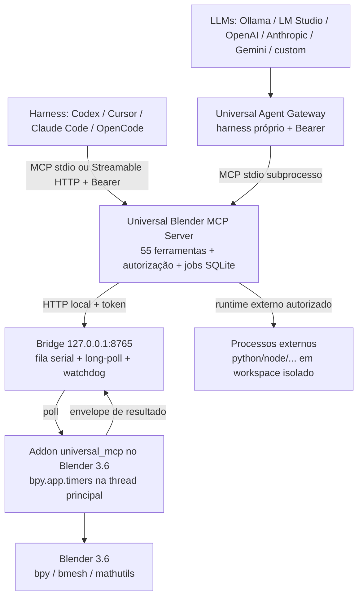

# Blender AI Automation

Automação do **Blender 3.6** (Windows) por LLMs e agentes via **Model Context
Protocol (MCP)**, com execução real de operações 3D, controle de permissões,
checkpoints e persistência de jobs.

O sistema executa operações no Blender (criar/modificar objetos, materiais,
nodes, rigging, animação, física, render, import/export, Python controlado),
em vez de apenas descrever como fazê-las.

## Índice

- [Visão geral](#visão-geral)
- [Arquitetura](#arquitetura)
- [Componentes e estrutura](#componentes-e-estrutura)
- [Pré-requisitos](#pré-requisitos)
- [Instalação](#instalação)
- [Como utilizar](#como-utilizar)
- [Catálogo de ferramentas MCP](#catálogo-de-ferramentas-mcp)
- [Recursos e prompts MCP](#recursos-e-prompts-mcp)
- [Configuração](#configuração)
- [Segurança](#segurança)
- [Runtime externo (multilíngue)](#runtime-externo-multilíngue)
- [Persistência e jobs](#persistência-e-jobs)
- [Testes](#testes)

## Visão geral

O projeto separa deliberadamente a inteligência (LLM/harness) da execução
(Blender), permitindo trocar de modelo ou de cliente sem reescrever o addon:

1. **Um servidor MCP único**, independente de fornecedor, expõe **55
   ferramentas** estruturadas (contrato do §6.1 do plano), recursos
   `blender://` e templates de prompt.
2. **Dois caminhos de integração**:
   - **Caminho A** — seu harness favorito (Codex, Claude Code, Cursor,
     OpenCode ou outro cliente MCP) fala diretamente com o servidor.
   - **Caminho B** — o **Universal Agent Gateway** (harness próprio) conecta
     modelos locais (Ollama, LM Studio) ou cloud (OpenAI, Anthropic, Gemini,
     endpoints compatíveis) ao mesmo servidor, inclusive sem tool calling
     nativo (fallback para JSON validado).
3. **Controles de execução por padrão**: bind local, **token Bearer na Bridge,
   no MCP HTTP e no Gateway**, 4 níveis de autorização aplicados no código
   (ferramentas **e** recursos), validação recursiva de argumentos, allowlist
   de caminhos fail-closed, aprovação explícita para operações avançadas/
   destrutivas, checkpoints antes de um subconjunto de ações destrutivas e
   auditoria de todas as chamadas.

## Arquitetura



Pontos essenciais da implementação:

- **Dois Pythons separados** (§3.2 do plano): o addon e a Bridge usam **apenas
  a biblioteca padrão** (compatíveis com o Python 3.10 embutido do Blender);
  o SDK MCP, Pydantic e demais dependências ficam no ambiente virtual externo
  `.venv`. Nada é instalado no Python do Blender.
- **Thread principal** (§5.1): a thread de rede do addon nunca toca `bpy`. Os
  comandos chegam por long-poll a uma `CommandQueue` e são executados por um
  timer `bpy.app.timers`; o resultado volta à Bridge como envelope padronizado.
  O desligamento faz `join` da thread de rede — nenhum processo/thread
  residual.
- **Fila serial na Bridge**: um comando ativo por vez — dois agentes não
  modificam a mesma cena simultaneamente. Watchdog converte comandos
  abandonados em falha estruturada (`Timeout`).
- **Envelope único** (§6.4) para toda ferramenta, inclusive as resolvidas no
  próprio servidor:

  ```json
  {
    "command_id": "cmd-…",
    "status": "completed",
    "success": true,
    "data": { "…": "…" },
    "scene_revision": 13,
    "error": null
  }
  ```

  `status` ∈ `queued | running | completed | failed | cancelled`; erros trazem
  `error.type` (ex.: `Unauthorized`, `ApprovalRequired`, `InvalidArguments`,
  `PathNotAllowed`, `PolicyBlocked`, `NotFound`, `BridgeUnavailable`,
  `Timeout`).

## Componentes e estrutura

| Diretório | Responsabilidade real |
|---|---|
| `blender_addon/universal_mcp/` | Addon "Universal Blender MCP": painel na 3D View, preferências, operadores, cliente da Bridge, fila thread-safe, **49 operações** com schemas JSON locais (`operation_schemas.py` + `operation_validation.py`), inspeção/serialização da cena, checkpoints, políticas locais |
| `mcp_server/` | Pacote `universal_blender_mcp`: servidor MCP (SDK v2, transports stdio/HTTP autenticado), Bridge HTTP, registro das 55 ferramentas, autorização única de ferramentas e recursos, jobs SQLite, auditoria, recursos e prompts empacotados |
| `agent_gateway/` | Harness próprio: orquestrador + API HTTP autenticada, 5 adaptadores de LLM, cliente MCP stdio, planejamento, loop de execução e validação |
| `external_runtime/` | Execução de processos externos com runtimes autorizados, workspace confinado, timeout e limites de saída |
| `prompts/` | `system_prompt.md` (§10), `task_prompt.template.md` (§11) e 5 guias de domínio (`skills/`); cópia empacotada em `mcp_server/src/universal_blender_mcp/prompts/` com teste de paridade |
| `config/` | `app.toml`, `providers.yaml`, `policies.yaml` e exemplos de registro em `clients/` |
| `scripts/` | Instalação/inicialização/empacotamento (`install.ps1`, `start-server.ps1`, `package-addon.ps1`), conexão ponta a ponta real (`test-connection.ps1`), compilação (`check_compile.py`) e diagnósticos MCP com deadline (`diag_*.py`, `mcp_diag_client.py`) |
| `tests/` | Suítes `unit`, `integration`, `security`, `compatibility`, `blender_background` |
| `storage/` | `projects/`, `checkpoints/`, `renders/`, `logs/`, `external_workspace/`, `jobs.db`, `bridge_token`, `http_token`, `gateway_token` |
| `dist/` | ZIP do addon gerado por `package-addon.ps1` |

## Pré-requisitos

- **Windows** (projeto desenvolvido e testado em Windows 10).
- **Blender 3.6** — verificado com a instalação local `C:\Blender\blender 3.6`
  (3.6.0/3.6.2, Python embutido 3.10). Outros caminhos podem ser informados
  pela variável `BLENDER_EXE` nos testes.
- **Python externo ≥ 3.10** para o servidor/gateway. O plano recomenda
  3.11/3.12; nesta máquina o ambiente foi criado e validado com **3.15.0**.
  O `install.ps1` tenta `py -3.12`, `py -3.11` e depois `python`.
- **PowerShell**: todos os `.ps1` são **ASCII** e parseiam tanto no **Windows
  PowerShell 5.1** (decodificação padrão) quanto no **PowerShell 7** —
  verificado por teste (`tests/compatibility/test_powershell_scripts.py`).
  Não é mais necessário usar `pwsh` para evitar falha de parse.
- **Node.js** — apenas se quiser usar o MCP Inspector (`start-server.ps1
  -Inspect`).
- **Git** — recomendado para versionamento, não necessário para executar
  (não há repositório Git inicializado neste diretório).
- Para o Caminho B: um provedor configurado em `config/providers.yaml`
  (serviço local no ar ou variável de ambiente com a chave da API).

## Instalação

Na pasta do projeto (`C:\Blender\RPA`), em PowerShell:

```powershell
# 1) Ambiente externo: venv + dependências + verificação rápida
#    (cria .venv, instala mcp[cli], pydantic, httpx, fastapi, uvicorn,
#     python-dotenv, pyyaml, pytest, pytest-asyncio e o pacote mcp_server)
.\scripts\install.ps1
#    Opções: -SkipVenv (usa o Python atual) | -SkipTests
```

Comportamento garantido nesta versão (regressões em
`tests/compatibility/test_powershell_scripts.py`):

- Cada etapa nativa (`py`, `python`, `pip`, `pytest`) roda via helper
  fail-fast: **qualquer falha encerra o script com exit code não-zero** — não
  existe mais "Instalação concluída" após erro de pip/compilação/testes.
- A instalação **editável** de `mcp_server` é obrigatória; os comandos
  `python -m universal_blender_mcp` funcionam sem `PYTHONPATH`.
- `-SkipVenv` usa exatamente o Python selecionado (sem criar venv) e
  **regrava os caminhos dos clientes** em `config/clients/*.json` para o
  intérprete escolhido.
- Caminhos com espaços e apóstrofos são suportados (regressão dedicada).
- Gate final da instalação isolada: `python -m universal_blender_mcp inspect`
  executa sem `PYTHONPATH` e sem efeitos colaterais (não cria
  `storage/`, token, `jobs.db` nem logs).

```powershell
# 2) Empacotar o addon
.\scripts\package-addon.ps1
#    Gera dist\universal_mcp-0.1.0.zip com TODOS os 19 módulos atuais
#    (sem __pycache__/.pyc). Verificação de conteúdo/hash:
#    .\.venv\Scripts\python.exe -I .superpowers\sdd\2026-11-08-phase-6-e2e\task7-verify-zip.py
```

O `agent_gateway` não é instalado pelo `pyproject.toml` de `mcp_server`;
execute o gateway a partir da raiz do projeto.

No **Blender 3.6**:

1. `Edit → Preferences → Add-ons → Install…` e selecione o ZIP de `dist\`.
2. Ative **Universal Blender MCP**.
3. Abra a 3D View, pressione `N` e acesse a aba **Universal MCP**.
4. Em preferências do addon, informe o token de `storage\bridge_token`
   (criado atomicamente na primeira execução do servidor/Bridge) e o
   endereço/porta da Bridge. O painel permite conectar/desconectar, testar,
   criar checkpoints, abrir logs e enviar um Task Prompt ao gateway.
5. Configure `renders_dir = C:\Blender\RPA\storage\renders` e
   `checkpoints_dir = C:\Blender\RPA\storage\checkpoints` explicitamente.
   Quando o addon é instalado pelo ZIP, o cálculo padrão a partir de `__file__`
   não aponta para a raiz do projeto; sem esses ajustes, `render_inspect` pode
   não encontrar os renders e o botão de logs usa outro diretório.

Para subir os serviços:

```powershell
.\scripts\start-server.ps1 -BridgeOnly     # somente a Bridge (127.0.0.1:8765)
.\scripts\start-server.ps1                 # servidor MCP em stdio
.\scripts\start-server.ps1 -Transport http # MCP Streamable HTTP (127.0.0.1:8766)
.\scripts\start-server.ps1 -Gateway        # Agent Gateway (127.0.0.1:8767)
.\scripts\start-server.ps1 -Inspect        # MCP Inspector via npx
```

> O servidor MCP pode iniciar a Bridge automaticamente
> (`server.autostart_bridge = true` em `config/app.toml`).

## Como utilizar

### Caminho A — harness existente

Exemplos prontos em `config/clients/` (caminhos já apontam para
`C:\Blender\RPA`; o instalador regrava o intérprete quando necessário):

```powershell
# Codex
codex mcp add blender-universal -- "C:\Blender\RPA\.venv\Scripts\python.exe" -m universal_blender_mcp
codex mcp list

# Claude Code
claude mcp add --transport stdio blender-universal -- "C:\Blender\RPA\.venv\Scripts\python.exe" -m universal_blender_mcp
claude mcp list

# OpenCode
opencode mcp add blender-universal -- "C:\Blender\RPA\.venv\Scripts\python.exe" -m universal_blender_mcp
opencode mcp list
```

**Cursor**: copie o bloco `mcpServers` de `config/clients/cursor.json` para
`.cursor/mcp.json` (projeto ou `%USERPROFILE%\.cursor\mcp.json`).

Os comandos acima são as formas de registro previstas no plano; **não foram
executados neste ambiente** (os clientes não estão instalados aqui).

**MCP Streamable HTTP (opcional, autenticado)**: com
`start-server.ps1 -Transport http`, todo request exige
`Authorization: Bearer <token>`:

- Resolução do token: variável `BLENDER_MCP_HTTP_TOKEN` → arquivo
  `storage\http_token` → geração exclusiva na primeira subida em loopback.
- Token ausente ou errado → **401**; corpo maior que
  `server.http_max_body_bytes` (1 MiB padrão) → **413**; JSON não-objeto →
  **400**.
- **Binding fora de loopback só sobe com token explicitamente configurado**
  (env ou arquivo já existente); caso contrário o servidor recusa a subida.
- O transporte **stdio não usa Bearer** — sua fronteira é o nível de sessão
  (`BLENDER_MCP_SESSION_LEVEL`) aplicado pelo servidor.

### Caminho B — Universal Agent Gateway (harness próprio)

```powershell
# API HTTP do gateway (provedor padrão = local_ollama)
.\.venv\Scripts\python.exe -m agent_gateway

# Listar provedores e roteamento
.\.venv\Scripts\python.exe -m agent_gateway --providers

# Executar uma tarefa única e imprimir o relatório
.\.venv\Scripts\python.exe -m agent_gateway --task "Crie um cubo chamado MCP_Cube"
```

API HTTP (padrão `127.0.0.1:8767`, **autenticada**):

| Método/rota | Função |
|---|---|
| `POST /task` | Corpo `{"prompt": "…", "provider": "local_ollama", "plan": true, "verify": [{"kind": "object_exists", "name": "MCP_Cube"}]}` → `202 {"id": "run-…"}` |
| `GET /tasks` | Lista execuções |
| `GET /tasks/{id}` | Status, eventos (observe/plan/tool_call/tool_result/verify/done), relatório e verificação |
| `GET /health` | Provedores, roteamento por papel (`planner/executor/reviewer/vision`) e contagem de runs |

Autenticação Bearer do Gateway: variável `BLENDER_GATEWAY_TOKEN` (definida em
`[gateway] auth_token_env`) → arquivo `storage\gateway_token` (gerado com
criação exclusiva na primeira subida). Token ausente/errado → **401** com
comparação em tempo constante; corpo maior que `max_request_bytes` → **413**;
`verify` inválido ou `provider` desconhecido → **400**. Eventos e relatórios
são redigidos contra as chaves de API cadastradas.

O gateway lança o próprio servidor MCP como subprocesso stdio e implementa
OBSERVE, PLAN, ACT e REPORT, com VERIFY opcional ao final. O modelo pode tentar
REPAIR durante o loop ao receber erros de ferramentas, mas uma verificação
final reprovada **não dispara automaticamente um novo ciclo de reparo**.
`provider_error`, `max_turns` e verificação reprovada não alteram
necessariamente o estado externo da run para `failed`; consulte `stop_reason`,
`verification` e o relatório, não apenas `status`. O planejador tem fallback
configurável (`[gateway] planner_fallback = fail | direct`): com `direct`, a
execução segue sem plano estruturado quando o provedor de planejamento falha.

Sem tool calling nativo, o gateway tenta interpretar uma ação JSON no texto
(§7.3). O histórico do fallback ainda é serializado como tool calling nativo
nos turnos seguintes, e as observações iniciais produzem `tool_result` sem uma
chamada anterior do modelo; providers estritos podem rejeitar esses payloads.
Modelos puramente textuais, portanto, têm automação limitada e não validada de
ponta a ponta.

### CLI do servidor

```text
python -m universal_blender_mcp                      # serve (stdio)
python -m universal_blender_mcp serve --transport http
python -m universal_blender_mcp bridge               # apenas a Bridge
python -m universal_blender_mcp inspect              # catálogo JSON das ferramentas
python -m universal_blender_mcp jobs --limit 20      # histórico SQLite
python -m universal_blender_mcp jobs --status failed
```

`inspect` é **livre de efeitos colaterais**: não cria `storage/`, token,
`jobs.db`, logs e não sobe a Bridge.

### Bridge (referência para integrações)

Autenticação por `X-Bridge-Token` ou `Authorization: Bearer <token>`
(`/status` é o único endpoint sem token).

| Rota | Função |
|---|---|
| `GET /status` · `GET /health` | Fila, comando ativo, revisão da cena, Blender conectado, estatísticas de jobs |
| `GET /blender/info` | Instância registrada (versões, capacidades) |
| `POST /register` | Registro do addon |
| `GET /poll?wait=1` | Long-poll de comandos pelo addon (máx. 5 s por chamada) |
| `POST /commands` | Submissão `{operation, arguments, idempotency_key?, dry_run?}` |
| `GET /commands/{id}` | Job + resultado |
| `POST /results` | Devolução do envelope pelo addon |
| `POST /commands/{id}/cancel` | Cancelamento de job ainda enfileirado |

## Catálogo de ferramentas MCP

São **55 ferramentas** — exatamente o contrato do §6.1 do plano. As marcadas
com *(servidor)* são resolvidas no processo do servidor; as demais são
despachadas ao addon com o mesmo nome de operação.

| Categoria | Ferramentas |
|---|---|
| Conexão (3) | `blender_ping`, `blender_get_version`, `blender_get_capabilities` *(servidor)* |
| Inspeção (4) | `scene_get_info`, `scene_list_objects`, `object_get_info`, `scene_get_selection` |
| Objetos (5) | `object_create`, `object_delete`, `object_duplicate`, `object_rename`, `object_transform` |
| Modelagem (4) | `mesh_edit`, `mesh_apply_modifier`, `mesh_boolean`, `mesh_validate` |
| Materiais/UV (6) | `material_create`, `material_assign`, `material_set_property`, `uv_unwrap`, `texture_load`, `texture_assign` |
| Nodes (4) | `nodes_list`, `nodes_create`, `nodes_connect`, `nodes_set_input` |
| Rigging (3) | `armature_create`, `bone_edit`, `rig_assign_weights` |
| Animação (4) | `animation_keyframe`, `animation_action`, `animation_fcurve`, `animation_nla` |
| Física (2) | `physics_configure`, `simulation_bake` |
| Câmera/luz (3) | `camera_configure`, `light_create`, `light_configure` |
| Renderização (3) | `render_configure`, `render_preview`, `render_final` |
| Arquivos (3) | `project_open`, `project_save`, `project_checkpoint` |
| Import/export (3) | `asset_import`, `asset_export`, `addon_operator_invoke` |
| Python (2) | `python_execute_blender`, `python_execute_external` *(servidor)* |
| Jobs (3) | `job_get_status`, `job_cancel`, `job_get_result` *(servidor)* |
| Validação (3) | `scene_validate`, `render_inspect` *(servidor)*, `object_compare` |

Detalhes úteis (assinaturas completas via `blender_get_capabilities` ou
`python -m universal_blender_mcp inspect`):

- `object_create`: primitivas `CUBE`, `UV_SPHERE`, `IO_SPHERE`, `CYLINDER`,
  `CONE`, `TORUS`, `PLANE`, `MONKEY`, `EMPTY`, `ARMATURE`, `CAMERA`;
  nome existente é **reutilizado** sem validar o tipo nem os demais parâmetros.
  Confira `object_type` no resultado: um objeto de outro tipo com o mesmo nome
  pode ser retornado em vez da primitiva solicitada. `light_create` tem
  limitação semelhante.
- `dry_run`: apenas confirma que a operação está registrada e devolve a nota
  “validação de argumentos apenas”; **não executa a validação dos argumentos**
  nem simula seus efeitos nesta versão.
- `object_delete(delete_data=true)`: remove os data blocks que ficarem sem
  usuários (`batch_remove`). A exclusão de vários nomes não é transacional:
  valide todos os objetos antes e crie checkpoint manual
  (`project_checkpoint`; o servidor também agenda checkpoint automático para
  `object_delete`/`project_open` quando `auto_checkpoint` está ativo).
- `mesh_edit.operations[]`: `EXTRUDE_REGION`, `EXTRUDE_FACES`,
  `EXTRUDE_VERTICES`, `INSET_FACES`, `BEVEL`, `SUBDIVIDE_EDGES`,
  `SUBDIVIDE_FACE`, `DELETE_*`, `MERGE_VERTICES`, `RECALC_NORMALS`,
  `FLIP_NORMALS`, `SMOOTH_VERTICES`, `TRIANGULATE`, `FILL_HOLE`,
  `SHADE_SMOOTH/FLAT`, `SET_ORIGIN_TO_GEOMETRY`, `MIRROR_X/Y/Z`.
  **`LOOP_CUT` não é suportado** (exige contexto interativo) e retorna erro
  estruturado.
- `mesh_apply_modifier`: `action = ADD | APPLY | REMOVE`, com `type`
  (`SUBSURF`, `MIRROR`, `BEVEL`, `ARRAY`, `SOLIDIFY`, `GEOMETRY_NODES`, …)
  e `params` filtrados pelos atributos existentes.
- `addon_operator_invoke`: `mode = LIST_ADDONS | LIST_OPERATORS |
  OPERATOR_INFO | INVOKE` (integração com addons, §8.2). `INVOKE` arbitrário
  exige nível `advanced` **e** aprovação explícita.
- `python_execute_blender`: executa na thread principal com `bpy`, `bmesh` e
  `mathutils` disponíveis; **atribua `result`** para retornar dados;
  stdout/stderr são capturados; o modo estrito bloqueia padrões perigosos
  antes do `exec`. Exige nível `advanced` **e** `approval: true` na chamada.
- `render_preview`/`render_final`: no Blender `--background` o render é
  síncrono; na interface gráfica, assíncrono (o comando fica `running` e é
  concluído pelos handlers `render_complete`/`render_cancel`). Esse caminho de
  interface não foi validado dinamicamente: previews podem deixar a porcentagem
  alterada. Não execute renders concorrentes e confirme o arquivo com
  `render_inspect`.
- `scene_validate`: com `fix=false` é **somente leitura** (a validação de malha
  roda sobre cópias e o reparo só é aplicado com `fix=true`, que exige nível
  `scene_write`). `object_compare` compara estatísticas e omite
  rotação/topologia/coordenadas; `equal=true` não prova igualdade real.
- Operadores Blender que retornam `{'CANCELLED'}`: o dispatcher verifica
  `poll()` e o resultado na maioria dos caminhos; restam dois operadores sem
  verificação exata em todos os caminhos (ver
  [Limitações conhecidas](#limitações-conhecidas)). Exportações (`asset_export`)
  selecionam apenas os objetos pedidos e restauram o estado de seleção.
- Caminhos relativos no estilo Blender (`//…`) são resolvidos contra a raiz do
  projeto `.blend` ativo e recusados quando esse contexto não existe;
  caminhos absolutos passam pela allowlist fail-closed de
  `config/policies.yaml`.

## Recursos e prompts MCP

Recursos (`resources/list` + templates):

```text
blender://runtime/info        blender://scene/summary
blender://scene/objects       blender://object/{name}
blender://materials           blender://jobs/{job_id}
blender://project/current
```

`resources/read` recebe **o mesmo gate de autorização da ferramenta
equivalente** (mapeamento recurso→ferramenta + nível + política + aprovação +
auditoria `resource_read`/`resource_denied`). Em particular,
`blender://materials` mapeia `python_execute_blender`: exige sessão
`advanced` e é negado em níveis inferiores; o código executado é 100%
construído pelo servidor (constante de listagem) e a aprovação sobre esse
código fixo vem do próprio servidor — um recurso nunca contorna o **nível**
da ferramenta equivalente. URI desconhecida → erro de protocolo. O
conteúdo é entregue no formato do SDK instalado (`TextResourceContents`).

Prompts (`prompts/list`, `prompts/get`): `blender_modeling`,
`blender_materials`, `blender_rigging`, `blender_animation`,
`blender_rendering` (conteúdo de `prompts/skills/`) e `blender_task`
(template de Task Prompt, argumento opcional `objective`). Quando o servidor
roda instalado (sem a pasta `prompts/` da raiz), os prompts são lidos da
cópia empacotada em `universal_blender_mcp/prompts/` — paridade garantida por
teste.

> Prompts MCP **não** são carregados automaticamente como System Prompt pelo
> harness (§6.3). Para instruções do agente, use `prompts/system_prompt.md`
> no mecanismo do seu cliente e o `AGENTS.md` na raiz.

## Configuração

### `config/app.toml`

| Seção | Principais chaves |
|---|---|
| `[bridge]` | `host = 127.0.0.1`, `port = 8765`, `token_file`, `queue_max = 16`, `command_timeout_s = 120`, `poll_interval_s` (consumido pelo `BridgeGateway`), `heartbeat_timeout_s` |
| `[server]` | `transport = stdio`, `http_host/http_port = 127.0.0.1:8766`, `autostart_bridge = true`, `log_level`, `http_auth_token_env`, `http_token_file`, `http_max_body_bytes = 1048576` |
| `[storage]` | Diretórios de projetos, checkpoints, renders, logs, `jobs.db`, workspace externo |
| `[gateway]` | `default_provider`, `max_turns`, `max_tool_calls_per_turn`, `http_port = 8767`, `max_runs`, `max_events_per_run`, `planner_fallback`, `max_request_bytes`, `auth_token_env`, `token_file` |
| `[external_runtimes.*]` | `executable`, `args`, `allowed` por runtime |
| `[external_runtime_limits]` | `timeout_s = 300`, `max_output_bytes`, `max_processes = 4` |

**Campo sem enforcement conhecido:** `checkpoints.max_keep` é declarado mas
não aplicado pelo servidor. O `auto_checkpoint` do YAML e as preferências do
addon são camadas independentes (o addon também faz checkpoint automático
quando a preferência está ativa).

Variáveis de ambiente reconhecidas: `BLENDER_MCP_ROOT` (raiz do projeto),
`BLENDER_MCP_SESSION_LEVEL` (`read_only|scene_write|project_ops|advanced`,
padrão = `authorization.default_level`), `BLENDER_MCP_HTTP_TOKEN` (Bearer do
MCP HTTP), `BLENDER_GATEWAY_TOKEN` (Bearer do Gateway), `BLENDER_EXE`
(testes) e as chaves de API referenciadas em `providers.yaml`.

### `config/providers.yaml`

Cadastro por provedor: `adapter` (`openai_compatible`, `anthropic`,
`gemini`, `ollama`, `custom`), `base_url`, `model`, `api_key_env`,
`tool_calling`, `vision`, `context_window`, `max_output`, `parameters`.
Entradas de exemplo: `local_ollama`, `local_lmstudio`, `cloud_openai`,
`cloud_anthropic`, `cloud_gemini`, `cloud_custom` (placeholders `MODEL_ID`
precisam ser substituídos). A seção `roles` declara roteamento por papel
(§7.4): `planner`, `executor`, `reviewer`, `vision`. Na implementação atual,
somente `planner` é consultado por `for_role()`; o executor usa o provider da
tarefa ou o primeiro cadastrado, e `reviewer`/`vision` não possuem consumidores
no gateway.

### `config/policies.yaml`

- `authorization.default_level` e `authorization.tool_levels` (sobreposições
  por ferramenta — nunca reduzem o nível mínimo do catálogo).
- `approval_required_tools` (além das elevações dinâmicas de
  `scene_validate(fix=true)`, Python e `addon_operator_invoke(INVOKE)`).
- `paths.allow` / `paths.deny` para operações com arquivos — **allowlist
  vazia nega tudo** (fail-closed), nunca libera.
- `python_execution.strict_patterns` (inclui `subprocess`, `os.system`,
  `shutil.rmtree`, `ctypes`, `socket.socket`, `urllib.request`, `requests`,
  `__import__`, …; cobre também `from módulo import nome`).
- `external_execution`, `checkpoints.auto_before_destructive`,
  `audit.log_all` e `audit.log_arguments` (ambos consumidos pelo servidor:
  `log_all=false` desliga a escrita de `audit.jsonl`; `log_arguments=false`
  oculta argumentos).

Em `external_execution`, `backend` identifica um adaptador de sandbox efetivo
registrado pelo host. Sem adaptador ativo, a ferramenta falha fechada com
`SandboxUnavailable`. O subprocesso comum só é habilitado quando
`allow_unsafe_host_execution: true` **e** a chamada inclui
`unsafe_approval_token: I_ACKNOWLEDGE_UNSANDBOXED_HOST_EXECUTION`; esse token é
uma confirmação explícita, não um segredo nem uma sandbox.

## Segurança

Mecanismos **implementados** (não apenas orientações de prompt):

| Camada | Controle |
|---|---|
| Rede | Bind padrão em `127.0.0.1`; token local em `storage/bridge_token` para a **Bridge**; **Bearer obrigatório no MCP Streamable HTTP** (`storage/http_token` ou `BLENDER_MCP_HTTP_TOKEN`, comparação em tempo constante, limite de corpo, JSON não-objeto rejeitado, binding fora de loopback exige token explícito); **Bearer obrigatório no Agent Gateway** (`BLENDER_GATEWAY_TOKEN` ou `storage/gateway_token`) |
| Servidor MCP | Autorização por ferramenta **e por recurso** antes do despacho: `read_only (1)`, `scene_write (2)`, `project_ops (3)`, `advanced (4)`; validação **recursiva** de argumentos (bool nunca passa por number/integer, objetos aninhados aplicam required/enum/itens); extração recursiva de caminhos (inclusive `params` e propriedades de operador); aprovação explícita para operações avançadas/destrutivas; metadados confiáveis `{level, approved}` injetados **após** a autorização — `requested_by` nunca é aprovação |
| Addon | Revalida permissões de Python e caminhos; scan textual auxiliar de padrões perigosos; valida argumentos contra os schemas locais; falha fechada sem metadados confiáveis; checkpoint automático para operações destrutivas |
| Runtime externo | Falha fechada sem backend de sandbox; confina scripts/cwd ao workspace, executa o caminho canônico do runtime, aplica cota global, captura limitada por bytes, ambiente mínimo e encerramento da árvore. O modo host explícito continua **sem** isolamento de filesystem/rede |
| Auditoria | `storage/logs/audit.jsonl` (chamadas, resultados, negações, leituras de recurso) + `server.log` rotativo por instância; `audit.log_all=false` desliga a gravação e `audit.log_arguments=false` oculta argumentos |

**Restrições importantes:** mantenha MCP HTTP e Gateway em loopback; não os
exponha sem uma camada externa de autorização e TLS — o Bearer protege contra
uso anônimo, não substitui TLS nem controle fino por cliente. A allowlist não
cobre 100% das propriedades de arquivo do addon;
`addon_operator_invoke` pode invocar operadores com efeitos de filesystem
(por isso `INVOKE` arbitrário exige `advanced` + aprovação). O scanner Python
é uma blacklist textual contornável por aliases dinâmicos e não é aplicado
pelo servidor como etapa independente — é defesa adicional no addon.

Níveis típicos: leitura/inspeção/jobs = `read_only`; criação e edição de cena =
`scene_write`; `project_save/open`, import/export, `object_delete`,
`simulation_bake`, `render_final` = `project_ops`; `python_execute_*` =
`advanced`. Para liberar execução avançada em uma sessão, defina
`BLENDER_MCP_SESSION_LEVEL=advanced` conscientemente e envie
`approval: true` na chamada.

**Importante:** `python_execute_blender` executa código arbitrário com os
privilégios do Blender quando autorizado. A checagem estática é um controle
adicional, **não** uma sandbox de segurança (§14 do plano).

## Runtime externo (multilíngue)

`python_execute_external` usa os runtimes de `config/app.toml`, mas a política
padrão **não executa** um subprocesso host: `external_execution.backend` é nulo
e `allow_unsafe_host_execution` é falso. Um nome de backend só fica ativo se o
host registrar um adaptador de sandbox com o mesmo identificador; esta versão
não inclui um backend de sandbox embutido.

Scripts inline e `script_path` são resolvidos dentro de
`storage/external_workspace/`, inclusive após resolução de links. O executável
é o caminho canônico descoberto no registro, e a allowlist opcional é aplicada
a esse caminho. A cota `max_processes` é compartilhada por raiz de workspace;
timeouts são por chamada. stdout/stderr são drenados durante a execução sob um
orçamento combinado de bytes e decodificados sem produzir UTF-8 inválido. O
ambiente herdado limita-se a `COMSPEC`, `HOME`, `LANG`, `LC_ALL`, `LOCALAPPDATA`,
`PATH`, `PATHEXT`, `SYSTEMDRIVE`, `SYSTEMROOT`, `TEMP`, `TMP`, `TMPDIR`,
`USERPROFILE` e `WINDIR`, além de overrides seguros explícitos; nomes de
token/chave/senha/segredo não são propagados. Timeout encerra a árvore por Job
Object/`taskkill` no Windows ou grupo de processos no POSIX.

O modo `unsafe_host` exige os dois gates documentados acima e reporta esse nome
em `execution_mode`. Ele **não** restringe filesystem, rede, imports, CPU ou
memória; os controles de workspace, ambiente, saída e árvore são contenção
parcial, não sandbox. Execute nesse modo somente código confiável. O módulo
`external_runtime` também pode ser usado diretamente (`WorkspaceManager`,
`ProcessRunner`, `PythonRunner`, `RuntimeRegistry`).

## Persistência e jobs

- **SQLite** (`storage/jobs.db`): comando, operação, argumentos, estados com
  timestamps, resultado, erro, `idempotency_key`, `scene_revision`.
- **Cancelamento**: jobs **enfileirados** são cancelados de forma confiável
  via MCP (`job_cancel` remove o comando da fila com transição única;
  repetições são idempotentes — regressão dedicada). Jobs **em execução** não
  têm cancelamento cooperativo: terminam ou estouram o timeout da Bridge.
- **Idempotência limitada**: o replay confiável existe apenas para um job
  concluído cujo resultado ainda está na memória da mesma Bridge. Chaves
  reutilizadas enquanto o job está `queued/running`, em concorrência ou após
  reinício podem duplicar comandos ou produzir resposta sem o resultado
  original; não há constraint única nem reserva atômica da chave.
- **Checkpoints**: cópias `.blend` datadas em `storage/checkpoints/`, sem
  alterar o arquivo atual (`save_as_mainfile(copy=True)`).
- **Logs/auditoria**: `storage/logs/`.
- **Recuperação**: os registros SQLite sobrevivem a reinícios, mas a fila, o
  comando ativo e os resultados em memória não são reidratados. Uma
  operação interrompida dentro do Blender pode precisar ser refeita a partir
  do último checkpoint (§9.4); não trate o histórico como garantia de
  recuperação transacional.

## Testes

Estrutura real e comandos:

```powershell
# Suíte externa (unit, integration, security, compatibility)
.\.venv\Scripts\python.exe -m pytest tests\unit tests\integration tests\security tests\compatibility -q

# Dentro do Blender 3.6 real (usa BLENDER_EXE ou C:\Blender\blender 3.6\blender.exe)
.\.venv\Scripts\python.exe -m pytest tests\blender_background -q

# Tudo
.\.venv\Scripts\python.exe -m pytest tests -q

# Verificação estática de sintaxe de todo o projeto
.\.venv\Scripts\python.exe scripts\check_compile.py
```

| Suíte | Escopo |
|---|---|
| `tests/unit` | Parsers TOML/YAML (inclui apóstrofos), envelopes/validação recursiva, autorização, jobs SQLite, catálogo das 55 ferramentas, auditoria (handlers independentes, `log_all`/`log_arguments`), capabilities/policy, adaptadores de LLM e payloads, workspace externo |
| `tests/integration` | Bridge real + addon simulado (roundtrip, auth 401, idempotência, fila cheia, watchdog/timeout), `BridgeGateway`, **MCP stdio real** (handshake, catálogo, tools/call, negações, recursos com autorização equivalente e auditoria), **rede autenticada** (MCP HTTP Bearer/413/400, binding não-loopback, integração combinada com o Gateway) |
| `tests/security` | Allowlist fail-closed (inclusive tentativa de URL, traversal, links/junctions), scan de Python do addon/servidor, runtimes externos negados/ausentes/confinados, aprovação explícita, metadados confiáveis |
| `tests/compatibility` | Sintaxe Python 3.10 do addon via AST, imports restritos a stdlib+bpy, contrato dispatcher ↔ ferramentas, configs de clientes, presença/paridade dos prompts, scripts PowerShell parseáveis em 5.1 e 7, instalador e conexão |
| `tests/blender_background` | 22 verificações dentro do Blender real (factory startup, storage temporário, registro real via `/register`, orçamento único de deadline): ping, inspeção, criar/transformar/idempotência, material, bmesh transacional, Python permitido e bloqueado, `scene_validate` read-only/transacional, render Cycles com arquivo, export selected-only, save, checkpoint, job persistido, rollback, `project_open` sem crash |

Resultado atual nesta máquina: **400 passed** na suíte externa (pytest 9.x,
Python 3.15) e **22/22** no smoke do Blender, com o código compartilhado
compilando em Python 3.10.12 e os scripts PowerShell parseando em 5.1 e 7.
